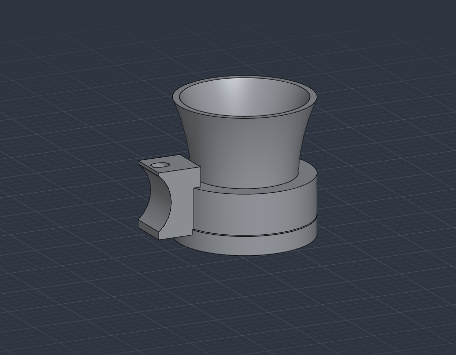

# Bike horn for a VW Tiguan tweeter

A handlebar-mounted parabolic horn that holds the **tweeter from a 2012 VW Tiguan** and clamps on with a zip tie. Two printed parts, no hardware.

Built around that tweeter: a Ø50 mm round body, 18 mm tall, with a 9 mm wiring notch on its side. **A 2014 Tiguan tweeter fits with only minimal changes** — the cavity size, nothing structural (see *Changing things*).

Designed in SolidCraft. Units are millimetres.

---

## What to print

| file | part | notes |
|---|---|---|
| `Horn-v2.stl` | horn + handlebar mount | the big one |
| `Cap-v2.stl` | screw-on back cap | screws onto the horn's collar |

Both are already exported from `tweeter-horn-v2.sc`. If you change the model, re-export both.

**Filament:** about **82 g total** — Horn 45.5 cm³ (≈59 g), Cap 18.3 cm³ (≈24 g). PETG is a good choice for something that lives outdoors on a bike; PLA will work but softens in a hot car.

## Printing

- **Cap**: print with the **threaded opening facing up**, flat face on the bed. No supports needed — the thread and the internal boss both grow cleanly.
- **Horn**: print **mouth up**, as modelled. The one place that wants support is the **Ø32 handlebar cradle** on the side of the mount — it is a horizontal tunnel, so support the top of that opening (or print with "support on build plate only" and let it bridge). The zip-tie tunnel and the wiring slot are vertical and need nothing.
- 0.2 mm layers, 3 perimeters, 20–25 % infill is plenty. The bell wall is 3 mm, so nothing here is fragile.

## Assembly

1. Push the tweeter into the back until it seats — the cavity is **Ø50.4 × 18.5 deep**, sized so the 2012 Tiguan tweeter sits flush with the throat plate.
2. Run the wires up the tweeter's own side notch and out through the **9 mm slot** in the horn's wall. The cap needs no wire cutout; the wire exits through the side, above the cap.
3. Screw the cap on — **M56×2**, about 3¼ turns, hand-tight. 0.2 mm of printed clearance is built in, so it should go on without forcing.
4. Zip tie through the tunnel in the mount block and around the bar; the block's Ø32 cradle takes the bar.

## Driving it

The horn is passive — it only loads the tweeter, so it needs an amplifier.

- An **MP3 board such as the DY-F20L** works well.
- Run it at **12 V or more**. Below that it is noticeably quiet.
- **A 5 W board is too quiet** — don't bother with one.
- **Higher voltage may be better still** — go up only as far as the board and the tweeter are rated for.

## Key dimensions

| | |
|---|---|
| tweeter | **2012 VW Tiguan** — Ø50 × 18, 9 mm wiring notch (2014 fits with a cavity tweak) |
| overall | Ø62 × 61.5 mm |
| tweeter cavity | Ø50.4 × 18.5 deep |
| throat / mouth | Ø40 → Ø62 |
| horn depth | 34 mm, 3 mm wall |
| handlebar | Ø32 at the cradle (change `bar_d` for a Ø22.2 bar) |
| zip tie | Ø6.5 tunnel |
| cap thread | M56×2, 6.5 mm engagement |

## Changing things

Most sizes are named parameters in `tweeter-horn-v2.sc` — `base_d`, `mouth_d`, `depth`, `bar_d`, `cap_t` and so on — so a change is usually one edit.

A few things to know before you try:

- Changing `mouth_d` or `depth` alone **distorts the bell**, because the two flare arcs have fixed control points. Ask for those two to be changed together.
- If the cap is **tight or loose**, change the `Collar skim` radius (currently **27.8**) by ±0.1 — lower is looser. Leave the cap's thread alone.
- **Fitting a different tweeter** — the 2014 Tiguan one included — means changing the cavity, not the rest of the part: `cav_d` (cavity Ø, now 50.4) and `tw_h` (cavity depth below the throat plate, now 18). If the new tweeter's wiring notch is a different width, `wire_w` (now 9). The mount, horn flare and thread are unaffected.

`HANDOFF.md` has the full feature tree, the exact joint dimensions, and the SolidCraft gotchas.

## Files

- `tweeter-horn-v2.sc` — the design (**current**)
- `Horn-v2.stl`, `Cap-v2.stl` — print files
- `tweeter-horn-v2-*.png` — renders (hero, cutaway, thread close-up, notch)
- `prompt` — the original brief
- `HANDOFF.md` — engineering handoff
- `horn.md` — running log of how it got here
- everything else (`tweeter-horn.sc`, `*-backup.sc`, old `.stl`/`.step`, `tweeter-horn-v2-snap.sc`, `Tweeter horn v3.sc`) — **history, do not print**
